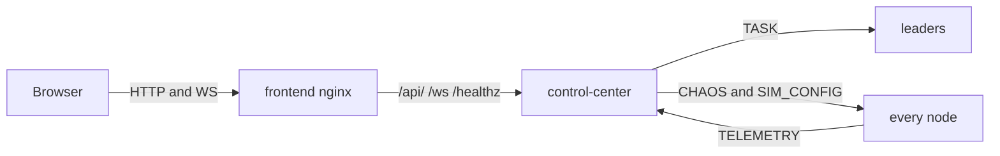
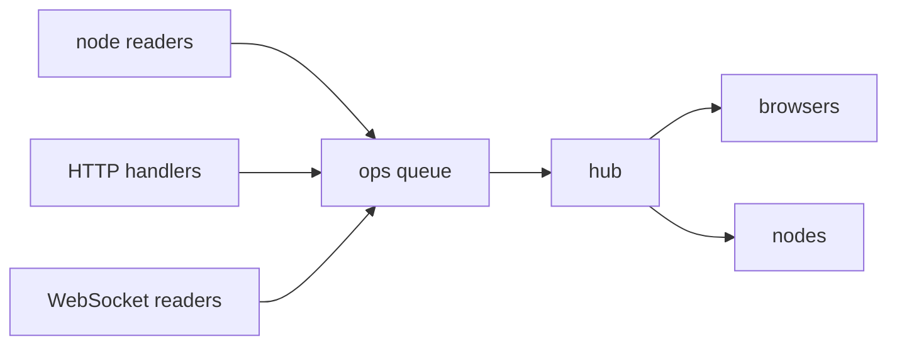
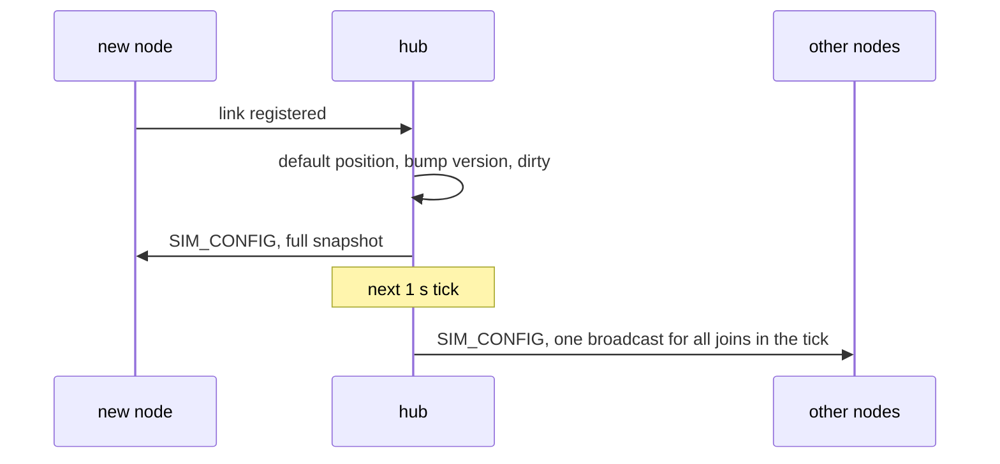
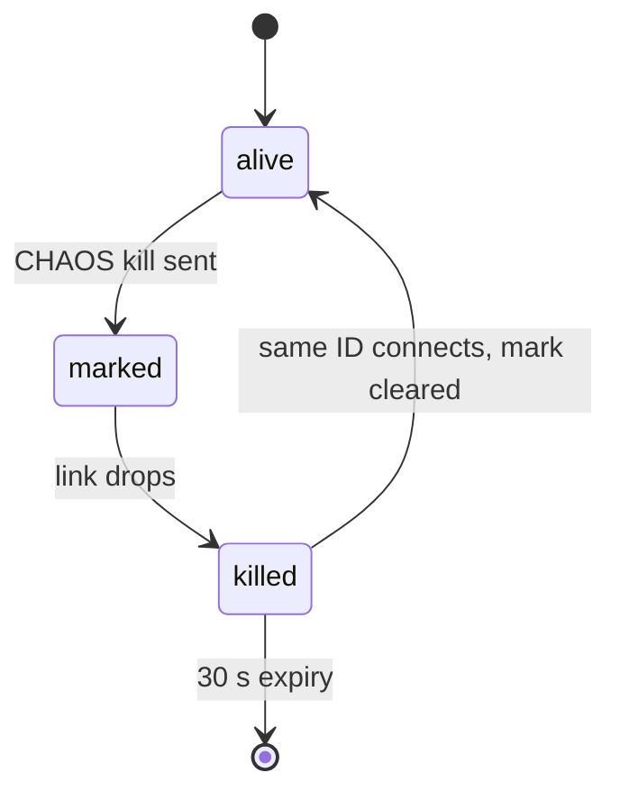
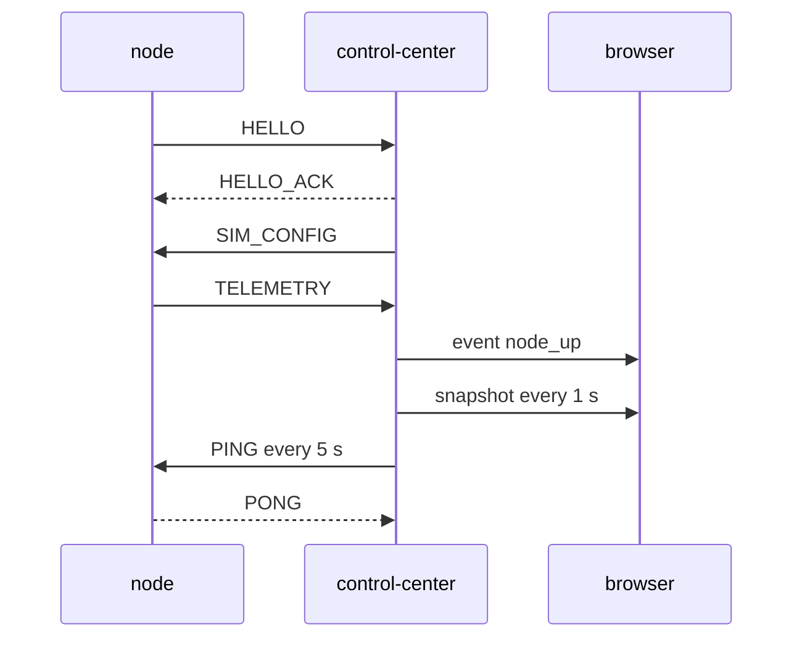
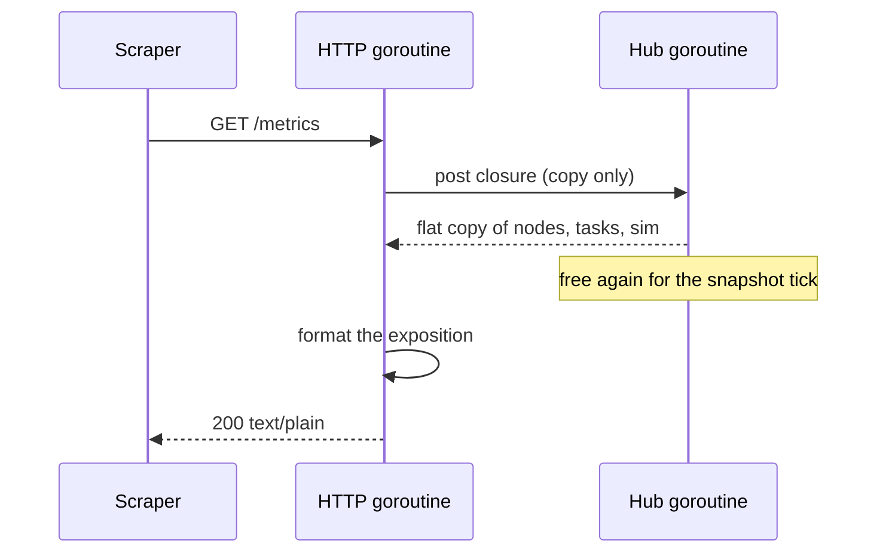
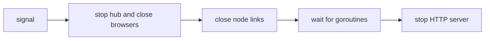

# The Control Center

The Control Center (CC) is one Go process with three jobs:

1. Accept a TCP link from every node and collect `TELEMETRY` and `TASK_RESULT`.
2. Serve a JSON API and a WebSocket feed.
3. Send `TASK` to leaders, `CHAOS` to any node, and `SIM_CONFIG` to every node.

It also owns the [latency simulation](./latency-simulation): every node's position, the latency
model and the election overrides.

It does **not** serve the dashboard. The `frontend` nginx container does that and forwards API
and WebSocket traffic to the CC.

The mesh does not need the CC. Stop it and elections, heartbeats and failover carry on.

Code: `backend/pkg/controlcenter/` (the server), `backend/pkg/telemetry/` (the node side),
`backend/cmd/control-center/` (wiring).

## Where it sits



| Port | Used by | Setting |
|---|---|---|
| `8080` | HTTP API and WebSocket, reached through nginx | `SWARM_CC_HTTP` |
| `7000` | node links (framed TCP) | `SWARM_CC_LISTEN` |

## Inside: one owner for all state

One goroutine, the **hub** (`backend/pkg/controlcenter/hub.go`), owns the node list, the task list,
the set of browsers, the sim state (`backend/pkg/controlcenter/sim.go`) and the set of killed
IDs. Everything else sends it small functions to run. No locks are needed.



- Every second the hub sends a `snapshot` to each browser. The same tick expires old nodes and
  flushes pending sim changes (see below).
- A browser joins the hub's client set *before* the upgrade is answered. By the time it holds
  the `101`, every event the hub emits reaches it; events are never replayed, so the other order
  would silently lose the ones raised in between. A hub that is gone answers `503` instead of
  opening a socket that closes at once.
- A browser that falls 64 messages behind is dropped. It reconnects and gets a fresh snapshot.
  Waiting for it would stall every node.
- If a node connects twice, the newest link wins and the old one is closed quietly.

## State the hub keeps for the simulation

| State | What it is |
|---|---|
| `sim.version` | starts at the CC's start time in ms. Every change: `max(version + 1, now_ms)`. |
| `sim.enabled`, `sim.params` | the emulation switch and `base_ms`, `per_unit_ms`, `jitter_ms` |
| `sim.threshold`, `sim.hysteresis` | operator overrides. `0` and `-1` mean none. |
| `sim.positions` | every node ever seen, plus placements for IDs not yet connected. At most 4096. |
| `sim.dirty` | new nodes joined and the others have not been told yet |
| `killed` | IDs the CC sent CHAOS kill to |
| per node `flowsAt` | when the latest `flows` sample arrived |



- A request that changes nothing does not bump the version.
- `SIM_CONFIG` sends run in their own goroutines (`sendAsync`), like `CHAOS`. A failed send is
  not retried. The next change carries the full state anyway.
- The body is encoded once per broadcast, not once per node.

## Killed nodes



- A killed node is shown with `state: "killed"` and `connected: false`, never as merely
  disconnected.
- The mark is set when the kill is sent, even though the send is asynchronous. It only shows
  once the link drops.
- On reconnect the old telemetry is thrown away. The new process starts clean.

## The node link

A node dials `SWARM_CONTROL_CENTER` and does the normal `HELLO` handshake. The CC's node ID is
`control-center`.

- The CC is **not** a mesh member. Its `HELLO_ACK` carries no peer list, so it never feeds
  addresses into the mesh.
- Node to CC: `TELEMETRY` every `SWARM_TELEMETRY_INTERVAL` (default 1 s), and `TASK_RESULT`
  when a task finishes.
- CC to node: `TASK` (leaders only), `CHAOS`, `SIM_CONFIG` (on connect and on every change),
  and a `PING` every 5 s so an idle link is not timed out. The node answers `PONG`.
- `TELEMETRY` also carries `threshold`, `hysteresis`, `sim_version` and `flows`. The CC
  truncates `flows` to 256 entries before rebroadcasting it.
- A node uses incarnation 0 on this link. If `SWARM_CONTROL_CENTER` points at a mesh node by
  mistake, that link loses to the real mesh link and does no harm.
- A lost link is redialled with backoff. The node keeps up to 256 results while it is down.



## HTTP API

| Path | Purpose |
|---|---|
| `GET /ws` | WebSocket, JSON text messages |
| `GET /api/state` | the latest snapshot as JSON |
| `POST /api/tasks` | submit tasks. Returns `{"task_ids":[...]}` |
| `POST /api/chaos` | inject a fault. Returns `{"ok":true}` |
| `GET /api/sim` | the current sim config |
| `POST /api/sim` | partial sim update. Returns the new sim config. |
| `GET /healthz` | returns `ok` |
| `GET /metrics` | Prometheus text exposition, see [Metrics](#metrics) |

Request rules:

- POST bodies must be `Content-Type: application/json` (else 415), at most 64 KiB, with no
  unknown fields or trailing data (else 400). Task `kind` is at most 64 bytes.
- Cross-site browser requests (a foreign `Origin` or `Sec-Fetch-Site`) get 403. This blocks a
  malicious web page from making your browser call `/api/chaos` or `/api/sim`.
- If `SWARM_CC_API_TOKEN` is set, POSTs need `Authorization: Bearer <token>` (else 401), and a
  WebSocket may only send commands if its upgrade carried the token. Reads stay open.
- Task `output` is capped at 512 bytes and ends in `...[truncated]` when cut.
- Slow clients are cut off: header and request deadlines, and at most 128 node handshakes in
  progress at once.

Errors are always JSON:

```json
{"error": "bad request: task kind is required"}
```

| Status | When |
|---|---|
| 400 | bad JSON, unknown field, missing `kind` or `node`, invalid chaos action or delay, threshold outside `[0, 1]`, bad position key, more than 4096 positions, sim fields mixed with task or chaos fields |
| 401 | token required and missing or wrong |
| 403 | cross-site browser request |
| 404 | chaos target is not connected |
| 415 | body is not JSON |
| 503 | no connected leader, or the CC is shutting down |

The WebSocket only accepts same-origin requests.

## Messages

Browser to server (also the POST bodies, where `type` is optional):

```json
{"type": "task", "kind": "sleep", "body": {"ms": 100}, "count": 5}
{"type": "chaos", "node": "node-2", "action": "delay", "delay_ms": 300}
{"type": "sim", "per_unit_ms": 3, "positions": {"node-3": {"x": 10, "y": 80, "z": 35}}}
```

- `count` defaults to 1, at most 100.
- `action` is `kill`, `delay` (0 to 5000 ms) or `clear`.
- A `sim` message has no reply. The browser sees the result in the `sim` event and the next
  snapshot. The full field list is in [Latency Simulation](./latency-simulation#_7-http-and-websocket).

Server to browser, every second (shortened):

```json
{"type": "snapshot", "at_unix_ms": 1790000000000,
 "sim": {"version": 1790000000123, "enabled": true, "base_ms": 1, "per_unit_ms": 2,
         "jitter_ms": 0.5, "threshold": 0, "hysteresis": -1,
         "size": 100, "max_delay_ms": 1500},
 "nodes": [{"id": "node-1", "role": "leader", "state": "alive", "term": 3,
            "leader": "node-1", "connected": true, "ledger_size": 4,
            "peers": [], "scores": {},
            "pos": {"x": 43.1, "y": 19.3, "z": 75.5},
            "threshold": 0.3, "hysteresis": 0.5, "sim_version": 1790000000123,
            "flows": [{"to": "node-2", "type": "HEARTBEAT", "count": 2}]}],
 "tasks": [{"task_id": "t-1", "kind": "echo", "leader": "node-1",
            "worker": "node-2", "state": "done", "ok": true}]}
```

Server to browser, as things happen:

```json
{"type": "event", "at_unix_ms": 1790000000000, "kind": "leader_change",
 "node": "node-3", "detail": "worker -> leader"}
```

Event kinds: `node_up`, `node_down`, `leader_change`, `state_change`, `task_done`, `chaos`, `sim`.

Notes on the snapshot:

- A node whose link dropped stays listed with `connected: false` for 30 s.
- `state` can be `killed` (see above).
- `pos` is where the CC placed the node. `threshold`, `hysteresis` and `sim_version` are what
  the node reports, not the CC's overrides. They are 0 until the node's first telemetry.
- `flows` is the latest sample, emptied once older than 3 s. Never null.
- `tasks` holds the newest 200 tasks.
- `missions` is present only while the MAVLink bridge holds a mission. It is the bridge's own
  state, pushed to the hub once a second, so it is at most one tick behind. Shape and fields:
  [MAVLink Bridge, section 5](./mavlink-bridge#_5-swarm-level-missions).
- A `score` of `-1` means **not measured yet**, not "excellent".

## Tasks through the CC

- The CC picks a leader round-robin from the latest telemetry.
- If a `TASK` cannot be queued, the task is marked `failed` at once.
- Delivery is at-least-once, so a result may arrive twice. The CC keeps the first.
- The CC keeps tasks in memory only. A CC restart forgets them.

## Metrics

`GET /metrics` publishes everything the hub knows in the Prometheus text exposition format
(`text/plain; version=0.0.4`). It is hand-rolled, like the wire protocol: no client library,
no registry, no extra module dependency.

```bash
curl -s http://127.0.0.1:8080/metrics | head -20
# cheap view: drop the per-pair family (see cardinality below)
curl -s 'http://127.0.0.1:8080/metrics?peer_scores=0'
```

Any method other than `GET` (or `HEAD`) gets 405. Auth is **exactly** what `GET /api/state`
does: reads are not token-gated, so a scrape needs no `Authorization` header even when
`SWARM_CC_API_TOKEN` is set. The token still guards every POST. `/metrics` is therefore not a
way around it -- it shows the same topology `/api/state` already does. Publishing the port is
publishing that topology; keep `BIND_ADDR` on loopback.

### Families

Swarm shape:

| Metric | Type | Notes |
|---|---|---|
| `swarm_build_info{version}` | gauge | constant 1 |
| `swarm_nodes{state}` | gauge | `alive`, `suspect`, `dead`, `killed`, always all four |
| `swarm_nodes_known` | gauge | in the table, connected or awaiting expiry |
| `swarm_nodes_connected` | gauge | live TCP links |
| `swarm_leaders` | gauge | connected nodes reporting role leader |
| `swarm_leader_threshold` | gauge | operator override, 0 for none |
| `swarm_leader_threshold_effective` | gauge | override, else the highest value connected nodes report, else 0 |
| `swarm_leader_target` | gauge | $\max(1, \lceil connected \times threshold \rceil)$, 0 while either input is unknown |
| `swarm_leader_hysteresis` | gauge | operator override, `-1` for none |

Per node, labelled `node="<id>"`:

| Metric | Type | Notes |
|---|---|---|
| `swarm_node_connected` | gauge | 0/1 |
| `swarm_node_leader` | gauge | 0/1. Role is a **value**, not a label: a label would start a new series on every promotion |
| `swarm_node_state{state}` | gauge | one series per canonical state, exactly one of them 1 |
| `swarm_node_term` | gauge | |
| `swarm_node_last_seen_ms` | gauge | age, not a timestamp |
| `swarm_node_dropped_frames_total` | counter | kept by the node, so it resets when that node restarts |
| `swarm_node_ledger_entries` | gauge | |
| `swarm_node_peers` | gauge | members in the node's own view |
| `swarm_node_degraded` | gauge | 1 while a chaos delay is in effect |
| `swarm_node_threshold`, `swarm_node_hysteresis` | gauge | what the node reports it is using |
| `swarm_node_sim_version` | gauge | compare with `swarm_sim_config_version` to spot a node that has not caught up |
| `swarm_node_position_units{axis}` | gauge | `axis` is `x`, `y`, `z`; cube units |

Health scores, tasks, simulation, bridge:

| Metric | Type | Notes |
|---|---|---|
| `swarm_peer_rtt_ms{from,to}` | gauge | what `from` measured for `to`. Milliseconds under the default latency strategy |
| `swarm_tasks{state}` | gauge | `pending`, `done`, `failed`, over the retained window of 200 |
| `swarm_task_duration_ms_sum` / `_count` | summary | same window. No histogram: the CC keeps no buckets, and inventing boundaries would publish numbers nothing measured |
| `swarm_sim_enabled`, `swarm_sim_base_ms`, `swarm_sim_per_unit_ms`, `swarm_sim_jitter_ms`, `swarm_sim_max_delay_ms`, `swarm_sim_size_units`, `swarm_sim_config_version` | gauge | the latency model the CC publishes |
| `swarm_mavlink_enabled` | gauge | 0/1, always published |
| `swarm_mavlink_frames_sent_total`, `swarm_mavlink_send_errors_total`, `swarm_mavlink_malformed_total`, `swarm_mavlink_dropped_total` | counter | only when a bridge is configured |
| `swarm_metrics_skipped_samples` | gauge | samples omitted because the value was NaN or Inf |

Reading rules:

- Swarm-level families are always present, even with an empty swarm, so a missing series means a
  broken scrape and never "no nodes yet". Per-node families then have a header and no samples.
- `swarm_tasks` and `swarm_task_duration_ms` describe a **window**, not a total. Both fall when
  old tasks are evicted. Use `sum / count` for the mean; do not use `rate()`.
- NaN and Inf are never published and never clamped to 0: the sample is skipped and
  `swarm_metrics_skipped_samples` counts it. An unmeasured health score (`-1`) is likewise absent,
  not a latency of minus one millisecond.
- `swarm_build_info`'s version comes from the CC's build string, falling back to the Go build
  info (`(devel)`) and then to `dev`.

### Cardinality: `swarm_peer_rtt_ms` is $O(N^2)$

Every node reports a score for every peer, so the family has up to $N \times (N-1)$ series.
That is 90 series at $N = 10$, 2450 at $N = 50$, and 999000 at $N = 1000$. Per-node families are
linear and much cheaper (about 20 series per node).

Turn it off per scrape with `?peer_scores=0` (also `false`, `no`, `off`). A query parameter,
not an env var, so it changes in `prometheus.yml` without restarting the CC:

```yaml
scrape_configs:
  - job_name: swarm-net
    scrape_interval: 15s
    static_configs:
      - targets: ["127.0.0.1:8080"]   # the frontend nginx, which proxies /metrics
    # drop the O(N^2) per-pair family on a large swarm
    # params:
    #   peer_scores: ["0"]
```

### Why a scrape cannot stall the swarm

The hub goroutine owns all CC state, and it also drives the 1 Hz snapshot every browser waits
on. So a scrape copies, then formats -- it never formats inside the hub.



The copy is flat on purpose: it does not reuse `Snapshot`, whose `NodeView` aliases the node's
live `peers` slice and `scores` map. Formatting those off-hub would be a read of hub-owned
memory that happens to work.

## Shutdown order



WebSockets go first because the HTTP server's shutdown does not close them. See
[Graceful Shutdown and Teardown Ordering](/concepts/graceful-shutdown-and-teardown-ordering).

## Common problems

| Symptom | Likely cause |
|---|---|
| `POST /api/tasks` returns 503 `no connected leader` | the first election has not finished yet |
| log says `control center uplink misconfigured` | `SWARM_CONTROL_CENTER` points at a mesh node |
| dashboard keeps reconnecting with close code 1008 | the tab fell 64 messages behind (for example a throttled background tab) |
| WebSocket fails with HTTP 403 | the `Origin` does not match the host. Check the nginx proxy headers. |
| a task stays `pending` forever | its result was lost, or the CC restarted |
| `POST /api/sim` returns 400 `threshold` | a threshold below 0 or above 1. Use 0 to clear. |
| a `sim` change made no `sim` event | the request changed nothing |
| a scrape shows no `swarm_node_*` samples | the swarm is empty; the headers are still there |
| `swarm_peer_rtt_ms` is huge | it is $O(N^2)$; scrape with `?peer_scores=0` |

## Related

- [WebSocket Framing and the HTTP Upgrade](/concepts/websocket-framing-and-upgrade)
- [CSP, Channels and the Memory Model](/concepts/csp-channels-and-memory-model)
- [Running the Swarm](./running-the-swarm)
- [Latency Simulation](./latency-simulation)
