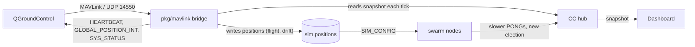
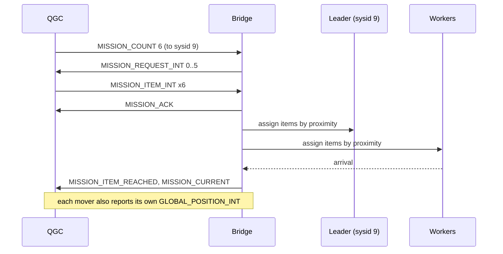
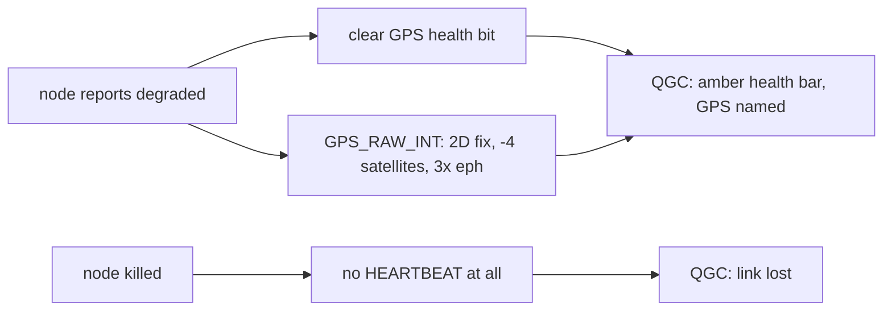

# MAVLink Bridge

The bridge makes the swarm visible in QGroundControl (QGC). Every node shows up as its own
vehicle, with live telemetry, and a mission planned in QGC is flown by a whole cluster
instead of by one aircraft.

Nothing in `backend/pkg/cluster/` or `backend/pkg/network/` changes. The bridge is a second
reader of state the Control Center (CC) already owns, plus a writer of positions.



| Piece | Code |
|---|---|
| Framing, CRC, message codecs | `backend/pkg/mavlink/` |
| Sysid assignment, vehicle state | `backend/pkg/mavlink/vehicles.go` |
| Mission protocol state machine | `backend/pkg/mavlink/mission.go` |
| Flight, idle drift, idle patrol | `backend/pkg/mavlink/mover.go` |
| Sensor health, GPS, battery, home | `backend/pkg/mavlink/health.go` |
| VFR_HUD and ATTITUDE | `backend/pkg/mavlink/instruments.go` |
| CC wiring | `backend/pkg/controlcenter/mavlink.go` |
| Config | `backend/cmd/control-center/config.go` |

## 1. Why positions are the integration point

The CC owns every node's position (`h.sim.positions`), and the latency model turns distance
into emulated RTT (see [Latency Simulation](./latency-simulation)). So moving a node is not
cosmetic:

1. The bridge moves a node toward a waypoint.
2. The CC pushes `SIM_CONFIG`, and that node's PONGs to distant peers get slower.
3. Health scores shift, and election or cluster membership follows.

Flying a leader into the far corner really does cost it its cluster. QGC and the dashboard
cannot disagree about it, because both read the same positions.

## 2. Coordinates

The swarm speaks an abstract cube, `0..100` per axis. QGC needs WGS-84. The bridge uses the
same metres-per-unit scale as the Blender exporter, then an equirectangular projection around
a lab origin:

$$lat = lat_0 + \frac{y \cdot k}{R} \cdot \frac{180}{\pi}, \qquad
  lon = lon_0 + \frac{x \cdot k}{R \cos(lat_0)} \cdot \frac{180}{\pi}, \qquad
  alt = alt_0 + z \cdot k$$

with $k$ metres per unit (default 20) and $R = 6378137$ m. Flat-earth error at lab scale
(2 km across) is under a metre, which is far below what this is for.

| Env var | Default | Meaning |
|---|---|---|
| `MAV_ORIGIN_LAT` | `47.397971` | Lab origin latitude |
| `MAV_ORIGIN_LON` | `8.546164` | Lab origin longitude |
| `MAV_ORIGIN_ALT` | `488` | Origin altitude, metres AMSL |
| `MAV_METRES_PER_UNIT` | `5` | $k$. The cube is 100 units across, so 5 gives a 500 m area |

`relative_alt` is height above the GROUND PLANE, which is cube `z = 0`, not height above a
vehicle's own position. A ground station shows relative altitude on the main flight display,
so measuring it from anywhere else makes the swarm look like it never left the ground.

The compose defaults are the VIT University lab origin. `backend/` keeps the ArduPilot SITL
origin as its built-in default, so the binary alone still opens on a sane map.

## 3. Sysid assignment

QGC identifies a vehicle by system id, so the mapping must be stable across reconnects.

1. If the node id ends in digits in `1..254` and that id is free, use it. `swarm-net-node-3`
   becomes sysid 3.
2. Otherwise take the highest free id, counting down from 254. `seed` gets 254.
3. An id is held for a node even while it is killed, so a restarted node keeps its vehicle.

Rule 2 counts DOWN for a reason found on a live swarm. Counting up gave `seed` (no digits,
and it connects early) id 1, so every numbered node found its own number taken and shifted:
node-3 became vehicle 4. A ground station then reported the wrong aircraft dying on a kill.
Keeping the low ids clear means a numbered node gets its number whatever order the swarm
starts in.

Component id is always 1 (`MAV_COMP_ID_AUTOPILOT1`).

## 4. Messages

Out, per vehicle:

| Message | Rate | Carries |
|---|---|---|
| `HEARTBEAT` (0) | 1 Hz | Liveness. `custom_mode` is 1 for a leader, 0 for a worker. Armed while flying. |
| `SYS_STATUS` (1) | 1 Hz | Sensor health bits, battery, plus dropped frames and ledger size mapped onto load and error counters |
| `BATTERY_STATUS` (147) | 1 Hz | The 6S pack: cell voltages, current, consumed charge, percentage |
| `GPS_RAW_INT` (24) | 1 Hz | Fix type, satellite count, dilution of position |
| `EXTENDED_SYS_STATE` (245) | 1 Hz | `ON_GROUND` at cube z = 0, `IN_AIR` otherwise |
| `HOME_POSITION` (242) | 1 Hz | Where drift is centred and where Return flies to |
| `GPS_GLOBAL_ORIGIN` (49) | 1 Hz | The local frame's origin, cube (0, 0, 0) |
| `GLOBAL_POSITION_INT` (33) | 5 Hz | Projected position, altitude, ground velocity |
| `ATTITUDE` (30) | 5 Hz | Roll, pitch, yaw and rates, derived from the Mover |
| `VFR_HUD` (74) | 5 Hz | Groundspeed, airspeed, heading, climb, throttle, altitude |
| `STATUSTEXT` (253) | on event | `leader_change`, `node_down`, re-election, mission reassignment |
| `MISSION_CURRENT` (42) | on change | Item the cluster is working on |
| `MISSION_ITEM_REACHED` (46) | on arrival | Completed item index |
| `AUTOPILOT_VERSION` (148) | on request | Capability bitmap: `MISSION_INT`, `MISSION_FLOAT`, `MAVLINK2` |

The 1 Hz messages all come from one read of a vehicle's state, and the 5 Hz
messages all come from one movement step, so the HUD can never argue with the
map.

**Why so many.** With only `HEARTBEAT`, `SYS_STATUS` and
`GLOBAL_POSITION_INT`, QGC shows a grey "not ready" health bar, no GPS lock, no
battery and no HUD: it has nothing to draw. Each message above turns one of
those off. `EXTENDED_SYS_STATE` also decides whether QGC offers Takeoff or Land,
and `HOME_POSITION` is what puts the home marker on the map and un-greys Return.

A node is a vehicle exactly while it heartbeats. A killed node stops, and QGC reports the
link lost -- which is what you want a failover to look like.

In: the mission protocol (`MISSION_COUNT`, `MISSION_REQUEST_LIST`, `MISSION_REQUEST_INT`,
`MISSION_ITEM_INT`, `MISSION_ACK`, `MISSION_CLEAR_ALL`, `MISSION_SET_CURRENT`),
`PARAM_REQUEST_LIST` (answered with a short read-only list, so QGC stops waiting on
parameters) and `COMMAND_LONG`. Unsupported commands are acked with `MAV_RESULT_UNSUPPORTED`
rather than ignored, because silence makes QGC retry forever.

Commands that do something: `MAV_CMD_COMPONENT_ARM_DISARM`, `NAV_TAKEOFF`, `NAV_LAND`,
`NAV_RETURN_TO_LAUNCH` and `MISSION_START`. Arming is not decoration -- `MISSION_START`
refuses while disarmed.

**`MISSION_REQUEST_LIST` must be answered for all three list types.** QGC asks every vehicle
for its mission, its geofence and its rally points the moment it connects. Leaving any one
unanswered produces:

```
Mission transfer failed. Error: Mission request list failed, maximum retries exceeded.
```

Fence and rally are always empty here, and are answered with `MISSION_COUNT` 0 rather than
ignored.

`HEARTBEAT` uses `MAV_AUTOPILOT_GENERIC`, not the ArduPilot id. Claiming ArduPilot makes QGC
demand a full parameter set and real flight modes.

`MAV_CMD_REQUEST_MESSAGE` is answered for `AUTOPILOT_VERSION`, `HOME_POSITION`,
`GPS_GLOBAL_ORIGIN` and `EXTENDED_SYS_STATE`. The requested message is sent
AFTER the `COMMAND_ACK`, because QGC waits for the ack before it starts looking
for the reply.

`AUTOPILOT_VERSION` advertises `MISSION_INT` and `MISSION_FLOAT` but NOT
`COMMAND_INT`: the bridge handles `COMMAND_LONG` only, and advertising a
capability it does not implement would earn silence on the one path that must
never be silent.

## 5. Swarm-level missions

This is the part that differs from a normal autopilot.

**Mission sent to a leader's sysid:** the leader's whole cluster flies it. Items are handed
out in sequence order, each to the idle member closest to that waypoint (the leader included).
Several nodes are therefore in the air at once, each on its own sysid in QGC.

**Mission sent to a worker's sysid:** that node flies it alone, the ordinary way.



On arrival at a waypoint the bridge also submits a real task to that node's leader, so a
waypoint lights up the existing `TASK` / `TASK_RESULT` path and shows in the dashboard's task
table. Flight is simulated; the task is not.

**When the leader dies mid-mission**, which is the demo worth showing:

1. Its vehicle stops heartbeating and QGC marks it lost.
2. The swarm re-elects, by its normal rules. The bridge does not vote.
3. Items neither reached nor in flight move to the new leader's cluster, and a `STATUSTEXT`
   on the new leader's sysid says so.
4. Items already in flight on surviving workers keep going. They are not re-planned.

A mission therefore survives the loss of the node it was uploaded to, which is the whole
point of the swarm underneath it.

## 6. Ground stations

The bridge keeps a SET of stations, not one address:

- Any station that sends a packet is learned and kept for 15 seconds past its last one.
- `MAV_GCS`, when set, is always a destination.
- Every message goes to all of them.

A single "newest sender" slot looks fine until two stations talk at once -- QGC plus a
diagnostic script, which is what a demo looks like. They then thrash the slot and each goes
silent a second at a time.

**Leave `MAV_GCS` empty unless a station cannot dial in.** Pointing it at a host where nothing
listens is actively harmful: the ICMP port-unreachable it provokes is reported by Linux on the
NEXT send on that socket, which is the one aimed at the real station. The symptom is telemetry
arriving at a fraction of its rate with `STATUSTEXT` missing entirely. Writes retry once per
destination for the same reason, and a learned station is dropped after 20 consecutive
failures.

## 7. Election stability while flying

Position drives emulated latency, and latency drives election. So flight perturbs the
election, which is the point -- and too much of it makes leadership flap every few seconds.

The margin is `SWARM_SIM_HYSTERESIS`, **in milliseconds of RTT**, not a ratio. The node
default is `0.5`, which suits a static swarm. At `per_unit_ms = 2` a drone crossing the cube
swings scores by hundreds of milliseconds, so 0.5 ms damps nothing.

| Setting | Effect |
|---|---|
| `-1` | Each node's own margin (0.5 ms). Leadership flaps during flight. |
| `40` | Compose default. About 20 units, or 100 m at `MAV_METRES_PER_UNIT=5`. Steady through a mission. |

A chaos kill still triggers failover at any setting: the margin only damps peaceful takeovers,
not the loss of a node.

## 8. Movement

| Env var | Default | Meaning |
|---|---|---|
| `MAV_SPEED_UNITS_S` | `3` | Flight speed toward a waypoint, cube units per second |
| `MAV_MOTION` | `drift` | What an idle node does: `drift`, `patrol` or `still` |
| `MAV_DRIFT` | `true` | Idle motion on or off. Overrides `MAV_MOTION` when false |
| `MAV_DRIFT_RADIUS` | `4` | Drift bound and patrol radius, in units |
| `MAV_DRIFT_SPEED` | `0.4` | Drift and patrol speed, units per second |

`drift` (the default, and the only behaviour before `MAV_MOTION` existed): nodes wander around
their home position on a seeded random walk pulled back toward home, so a node stays inside
`MAV_DRIFT_RADIUS` and never wanders off. The seed comes from the node id, so a restart drifts
the same way.

`patrol`: each node flies a slow circuit of radius `MAV_DRIFT_RADIUS` around its home, at
`MAV_DRIFT_SPEED`. At the defaults that is one lap a minute. The starting bearing comes from
the node id, so the fleet is spread around its circuits instead of flying in formation. Use it
for a demo: the swarm keeps moving on its own, with no mission uploaded.

`still`: nothing moves unless a mission or an operator moves it. Same as `MAV_DRIFT=false`,
which still wins if it is set.

**The trade-off, whichever mode you pick.** Position feeds emulated latency, which feeds the
election (section 1). Faster or wider motion therefore means more re-elections, and at some
point you lose the ability to say what caused one. `patrol` moves further from home than
`drift` does, so pair it with a real election margin:

```bash
MAV_MOTION=patrol SWARM_SIM_HYSTERESIS=40 docker compose up -d
```

See section 7: the margin is in milliseconds of RTT, and the compose default of `40` is steady
through a mission. If you are debugging clustering rather than demoing, `MAV_MOTION=still`.

## 9. What is real and what is synthesised

A ground station draws everything it is told as a measurement. Most of what the
bridge tells it is not one. There is no airframe: no IMU, no magnetometer, no
GPS receiver, no battery. QGC will not show a vehicle as flyable without them,
so they are invented.

| Field | Source |
|---|---|
| Position, altitude, velocity | **Real.** Cube position the CC owns, projected |
| Leader or worker (`custom_mode`) | **Real.** The swarm's own election |
| Liveness (a vehicle heartbeats at all) | **Real.** The node's link |
| Dropped frames, ledger size | **Real.** Node telemetry |
| Degraded (one withdrawn health bit) | **Real.** The swarm's chaos-delay flag |
| Mission assignment and arrivals | **Real.** And each arrival submits a swarm task |
| Sensor health bits | Synthetic. Twelve sensors claimed; none exist |
| GPS fix type, satellites, eph/epv | Synthetic. The POSITION is real, the receiver is not |
| Battery voltage, current, percentage | Synthetic. A model drained by the Mover's speed |
| Roll, pitch, yaw and rates | Synthetic. Read backwards off the motion, kinematic not dynamic |
| Airspeed, throttle | Synthetic. Airspeed equals groundspeed: there is no wind |
| Firmware version, uid | Synthetic |
| Armed | A flag, not an airframe. It does gate mission execution |

Two rules keep this honest rather than decorative:

1. **No noise.** Nothing is fuzzed to look convincing. `GPS_RAW_INT` carries the
   same projected position as `GLOBAL_POSITION_INT`, because a station that saw
   them disagree would report a position-estimate failure.
2. **Derived from real state where possible.** The battery drains faster when a
   vehicle flies. The attitude comes from the velocity the Mover measured. A
   degraded node drops its GPS health bit AND its fix level, in the same tick.

### The sensor health mapping

`SYS_STATUS` claims twelve sensors present and enabled: 3D gyro, 3D
accelerometer, 3D magnetometer, absolute pressure, GPS, angular rate control,
attitude stabilisation, yaw position, Z altitude control, XY position control,
motor outputs, battery. Not claimed: differential pressure (no pitot on a
multirotor), optical flow, RC receiver (there is no pilot), geofence, terrain,
logging, prearm check.

A node the swarm reports as **degraded** (chaos `delay` injected) withdraws ONE
bit, `MAV_SYS_STATUS_SENSOR_GPS`, and drops to a 2D fix with four fewer
satellites. One bit, not the whole bitmap, for two reasons: a vehicle with every
sensor unhealthy is indistinguishable from one that has crashed, and the kill
demo needs "slow" to look different from "gone" -- a killed node stops
heartbeating altogether.



## 10. Running it

```bash
MAV_ENABLED=true docker compose up -d
```

**QGC on the same machine as Docker (the usual case).** Let QGC dial IN. The bridge learns
the ground station's address from its first packet and streams back to it, so nothing has to
route from the container to the host:

1. Compose publishes the bridge on `127.0.0.1:14555` (host) -> `14550` (container). The host
   port differs on purpose: QGC binds 14550 locally for its own listener.
2. In QGC: Application Settings -> Comm Links -> Add. Type UDP, Listening Port 14550, and add
   `127.0.0.1:14555` as a target host. Connect.

Vehicles appear within a second or two.

**QGC on another machine.** Set `MAV_GCS` to its address and the bridge pushes to it
unprompted. Outbound from a container to the Docker host is less reliable than it looks, which
is why dialling in is the default for a local station.

Either way the bridge answers whoever talks to it, so a station that connects is served even
when `MAV_GCS` is wrong or empty.
