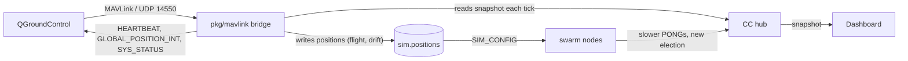
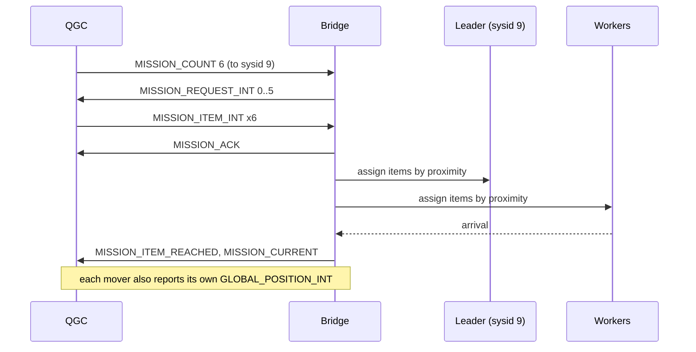

# MAVLink Bridge

The bridge makes the swarm visible in QGroundControl (QGC). Every node shows up as its own
vehicle, with live telemetry, and a mission planned in QGC is flown by a whole cluster
instead of by one aircraft.

Nothing in `backend/pkg/cluster/` or `backend/pkg/network/` changes. The bridge is a second
reader of state the Control Center (CC) already owns, plus a writer of positions.



| Piece | Code |
|---|---|
| Framing, CRC, message codecs | `backend/pkg/mavlink/` |
| Sysid assignment, vehicle state | `backend/pkg/mavlink/vehicles.go` |
| Mission protocol state machine | `backend/pkg/mavlink/mission.go` |
| Flight and idle drift | `backend/pkg/mavlink/mover.go` |
| CC wiring | `backend/pkg/controlcenter/mavlink.go` |
| Config | `backend/cmd/control-center/config.go` |

## 1. Why positions are the integration point

The CC owns every node's position (`h.sim.positions`), and the latency model turns distance
into emulated RTT (see [Latency Simulation](./latency-simulation)). So moving a node is not
cosmetic:

1. The bridge moves a node toward a waypoint.
2. The CC pushes `SIM_CONFIG`, and that node's PONGs to distant peers get slower.
3. Health scores shift, and election or cluster membership follows.

Flying a leader into the far corner really does cost it its cluster. QGC and the dashboard
cannot disagree about it, because both read the same positions.

## 2. Coordinates

The swarm speaks an abstract cube, `0..100` per axis. QGC needs WGS-84. The bridge uses the
same metres-per-unit scale as the Blender exporter, then an equirectangular projection around
a lab origin:

$$lat = lat_0 + \frac{y \cdot k}{R} \cdot \frac{180}{\pi}, \qquad
  lon = lon_0 + \frac{x \cdot k}{R \cos(lat_0)} \cdot \frac{180}{\pi}, \qquad
  alt = alt_0 + z \cdot k$$

with $k$ metres per unit (default 20) and $R = 6378137$ m. Flat-earth error at lab scale
(2 km across) is under a metre, which is far below what this is for.

| Env var | Default | Meaning |
|---|---|---|
| `MAV_ORIGIN_LAT` | `47.397971` | Lab origin latitude |
| `MAV_ORIGIN_LON` | `8.546164` | Lab origin longitude |
| `MAV_ORIGIN_ALT` | `488` | Origin altitude, metres AMSL |
| `MAV_METRES_PER_UNIT` | `20` | $k$, matches `world.metres_per_unit` in the Blender scene |

The defaults are the standard ArduPilot SITL origin, so QGC opens on a sane map before you
set your own.

## 3. Sysid assignment

QGC identifies a vehicle by system id, so the mapping must be stable across reconnects.

1. If the node id ends in digits in `1..254` and that id is free, use it. `swarm-net-node-3`
   becomes sysid 3.
2. Otherwise take the lowest free id. `seed` gets one this way.
3. An id is held for a node even while it is killed, so a restarted node keeps its vehicle.

Component id is always 1 (`MAV_COMP_ID_AUTOPILOT1`).

## 4. Messages

Out, per vehicle:

| Message | Rate | Carries |
|---|---|---|
| `HEARTBEAT` (0) | 1 Hz | Liveness. `custom_mode` is 1 for a leader, 0 for a worker. Armed while flying. |
| `GLOBAL_POSITION_INT` (33) | 1 Hz | Projected position, altitude, ground velocity |
| `SYS_STATUS` (1) | 1 Hz | Dropped frames and ledger size, mapped onto load and error counters |
| `STATUSTEXT` (253) | on event | `leader_change`, `node_down`, re-election, mission reassignment |
| `MISSION_CURRENT` (42) | on change | Item the cluster is working on |
| `MISSION_ITEM_REACHED` (46) | on arrival | Completed item index |

A node is a vehicle exactly while it heartbeats. A killed node stops, and QGC reports the
link lost -- which is what you want a failover to look like.

In: the mission protocol (`MISSION_COUNT`, `MISSION_REQUEST_LIST`, `MISSION_REQUEST_INT`,
`MISSION_ITEM_INT`, `MISSION_ACK`, `MISSION_CLEAR_ALL`), `PARAM_REQUEST_LIST` (answered with a
short read-only list, so QGC stops waiting on parameters) and `COMMAND_LONG`. Unsupported
commands are acked with `MAV_RESULT_UNSUPPORTED` rather than ignored, because silence makes
QGC retry forever.

`HEARTBEAT` uses `MAV_AUTOPILOT_GENERIC`, not the ArduPilot id. Claiming ArduPilot makes QGC
demand a full parameter set and real flight modes.

## 5. Swarm-level missions

This is the part that differs from a normal autopilot.

**Mission sent to a leader's sysid:** the leader's whole cluster flies it. Items are handed
out in sequence order, each to the idle member closest to that waypoint (the leader included).
Several nodes are therefore in the air at once, each on its own sysid in QGC.

**Mission sent to a worker's sysid:** that node flies it alone, the ordinary way.



On arrival at a waypoint the bridge also submits a real task to that node's leader, so a
waypoint lights up the existing `TASK` / `TASK_RESULT` path and shows in the dashboard's task
table. Flight is simulated; the task is not.

**When the leader dies mid-mission**, which is the demo worth showing:

1. Its vehicle stops heartbeating and QGC marks it lost.
2. The swarm re-elects, by its normal rules. The bridge does not vote.
3. Items neither reached nor in flight move to the new leader's cluster, and a `STATUSTEXT`
   on the new leader's sysid says so.
4. Items already in flight on surviving workers keep going. They are not re-planned.

A mission therefore survives the loss of the node it was uploaded to, which is the whole
point of the swarm underneath it.

## 6. Movement

| Env var | Default | Meaning |
|---|---|---|
| `MAV_SPEED_UNITS_S` | `3` | Flight speed toward a waypoint, cube units per second |
| `MAV_DRIFT` | `true` | Idle drift on or off |
| `MAV_DRIFT_RADIUS` | `4` | Maximum drift from the home position, in units |
| `MAV_DRIFT_SPEED` | `0.4` | Drift speed, units per second |

Idle nodes wander around their home position: a seeded random walk pulled back toward home,
so a node stays inside `MAV_DRIFT_RADIUS` and never wanders off. The seed comes from the node
id, so a restart drifts the same way.

Drift is deliberately slow. Position feeds latency feeds election, so fast drift makes
elections flap and you lose the ability to say what caused a re-election. If you are
debugging clustering rather than demoing, set `MAV_DRIFT=false` and nodes hold still.

## 7. Running it

The bridge sends to QGC; QGC does not dial in. Point the CC at the host:

```bash
# .env
MAV_ENABLED=true
MAV_GCS=host.docker.internal:14550
```

Then in QGC, add a UDP link on 14550 and leave the target empty. Vehicles appear within a
second or two.

If QGC runs on another machine, set `MAV_GCS` to its address. The bridge also learns the
sender address of any MAVLink packet it receives, so an inbound connection works without
configuration.
