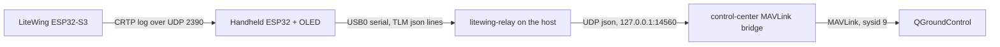
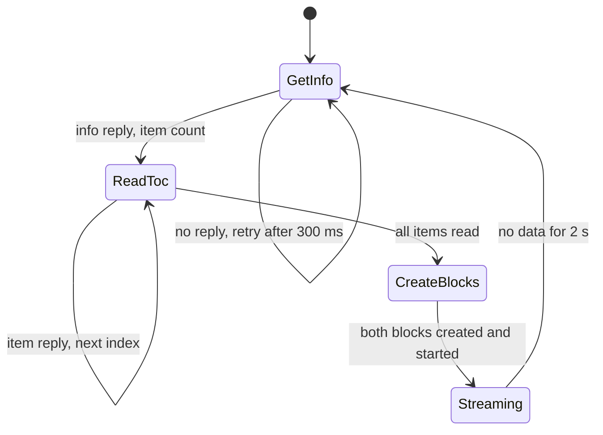

# LiteWing as a live swarm vehicle -- design

Date: 2026-10-20. Status: approved.

## Goal

A real LiteWing quadcopter (ESP32-S3, ESP-Drone firmware) backs one swarm node.

- The handheld ground unit (ESP32 + SH1106 OLED, on USB0) shows the drone's real
  telemetry.
- QGroundControl shows the same telemetry on that node's vehicle (sysid 9).
- Everything else about the swarm is unchanged.

Read-only. Nothing in this design can command the drone.

## Data path



Why this shape:

- The laptop's only Wi-Fi card is on the campus network, so the laptop does not
  join the drone's access point. The handheld does, and is free to: in sim and
  NRF modes nothing else uses its Wi-Fi.
- The relay runs on the host, not in a container: the USB serial device keeps
  re-enumerating, and its permissions reset each time. A host process can just
  reopen it.
- The drone is not reflashed. Its firmware already serves the standard Crazyflie
  log protocol (CRTP) over its own access point.

## Facts about the drone (verified 2026-10-20)

From its boot log and the `espressif/esp-drone` source at `db0f656`:

| Item | Value |
|---|---|
| Access point | `LiteWing_80456B54AA55`, WPA2 `12345678`, channel 6 |
| Drone address | `192.168.43.42` (the AP gateway), UDP port 2390 |
| Framing | One CRTP packet per datagram, plus a trailing checksum byte: the 8-bit sum of all preceding bytes |
| Reply address | The drone replies to the source of the LAST packet it received, so the handheld keeps one source port |
| Link watchdog | With no packet received for 1000 ms, the drone resets all log blocks |
| Log blocks | At most 26 payload bytes per block, 16 blocks |

**Hazard found in the source:** a 7-byte datagram starting with `now` is read as
a flight setpoint (`detectEspNow` in `wifilink.c`). The handheld sends only
port 5 (log) packets, header `0x5X`, and port 15 channel 2 (link sink, ignored),
header `0xF2`. Neither can start with `n` (`0x6E`). The encoder enforces this
with a test.

## Component 1: handheld firmware

`DRONE_SOURCE` replaces the boolean `DRONE_SIM_MODE`:

| Value | Name | Frames come from |
|---|---|---|
| 0 | `DRONE_SOURCE_NRF` | The NRF24 radio, as before |
| 1 | `DRONE_SOURCE_SIM` | The on-board flight simulator, as before |
| 2 | `DRONE_SOURCE_LITEWING` | The LiteWing, over Wi-Fi. **New default** |

`-DDRONE_SIM_MODE=0` and `=1` still work, mapped to NRF and SIM, so existing
build commands keep their meaning.

### `crtp_log.h` -- the protocol, as plain C++

No Arduino headers, host-tested like `flight_sim.h`. It owns:

- **Encoding** a datagram (CRTP header, payload, checksum) and **decoding** one,
  rejecting a bad checksum, an empty datagram and an oversize one.
- **A client state machine** that is fed received datagrams and the clock, and
  returns the next datagram to send:



- **The table of contents.** It reads every entry (TOC_GET_ITEM_V2) and keeps
  only the ids of the variables it wants, by name. A wanted variable that is
  missing is simply left out of its block, and reported, rather than failing the
  whole link.
- **Two log blocks**, each under the 26-byte limit:

| Block | Rate | Variables | Bytes |
|---|---|---|---|
| 1 | 10 Hz | `stabilizer.roll`, `.pitch`, `.yaw`, `.thrust` (float), `range.zrange` (uint16 mm), `pm.vbat` (float), `sys.armed` (int8) | 23 |
| 2 | 2 Hz | `motor.m1`..`m4` (requested as uint16), `pm.batteryLevel` (uint8), `pm.state` (int8) | 10 |

- **A keepalive** (`0xF2`, link sink) every 250 ms while streaming, well inside
  the 1 s watchdog.
- **Decoded samples** go into a `LiteWingTelemetry` struct: attitude in degrees,
  thrust, altitude in metres, battery volts and percent, armed, motors, and the
  sample's drone timestamp.

Values are taken as the drone sends them, with three guards:

- A non-finite float is dropped, keeping the previous value.
- Altitude above 8 m is treated as "out of range" (the VL53L0X returns 8190 mm
  when it sees nothing). It shows as `---`.
- Battery percent is clamped to 0..100.

### The sketch

- In `DRONE_SOURCE_LITEWING` mode it joins the drone's AP, binds one UDP port
  and runs the client. The HTTP API and the NRF24 are not started.
- **OLED:** a LiteWing telemetry screen in the same visual style:
  - Row 1: battery volts and percent, and the heartbeat dot.
  - Row 2: link RSSI (the real Wi-Fi signal in dBm) and altitude.
  - Rows 3-4: roll, pitch and yaw, then thrust and ARMED or DISARMED.
- **Lost link:** 2 s with no sample shows the existing `NO CONNECTION` screen,
  reading `Waiting LiteWing` before the first sample. The NRF timeout stays at
  10 s.
- **Serial:** each block-1 sample prints one `TLM {json}` line, and other logs
  keep their `[LW]` prefix:

```text
TLM {"src":"litewing","t":123456,"roll":1.2,"pitch":-0.4,"yaw":87.0,"thrust":0,"alt":0.05,"vbat":3.98,"pct":86,"armed":0,"rssi":-47,"m":[0,0,0,0]}
```

`alt` is `null` when out of range. The relay keys on `TLM ` and ignores every
other line.

## Component 2: `backend/cmd/litewing-relay`

A small Go program, standard library only.

- Opens the serial device (`-port /dev/ttyUSB0`, `-baud 115200`) raw, through
  Linux termios in `syscall`.
- Reads lines. A line starting with `TLM ` is parsed and validated, then
  forwarded as one UDP datagram to `-to 127.0.0.1:14560`. Every other line is
  ignored.
- On a read error or EOF (unplugged, re-enumerated), it closes the port and
  reopens it every second until it is back. A permission error says how to fix
  it.
- Logs a one-line summary every 10 s: lines read, forwarded, rejected.

It forwards only what validated, so the bridge never sees half a line.

## Component 3: the bridge's live-vehicle override

New settings, both empty or off by default, so a stock run is unchanged:

| Env | Default | Meaning |
|---|---|---|
| `MAV_LIVE_NODE` | empty | Node id whose telemetry comes from the live feed, e.g. `swarm-net-node-9` |
| `MAV_LIVE_BIND` | `:14560` | UDP address the feed is received on |

Compose publishes the port on `127.0.0.1` only.

The bridge's loop owns a `liveFeed` value: the newest sample and the time it
arrived. Samples come from a reader goroutine through a channel, the same
pattern as `readLoop`, so no state is shared across goroutines.

For the live node, while the newest sample is under 1.5 s old:

| Message | Field | Source |
|---|---|---|
| ATTITUDE | roll, pitch, yaw, rates | Drone (rates differentiated across samples) |
| SYS_STATUS, BATTERY_STATUS | voltage, remaining | Drone; 1S pack so one cell |
| GLOBAL_POSITION_INT | relative_alt | Range sensor |
| VFR_HUD | alt, throttle | Range sensor, thrust as percent of 65535 |
| HEARTBEAT | armed flag | `sys.armed`, or any motor spinning |

Latitude and longitude stay the swarm's, because the drone has no GPS. Mission
and command handling for the node are unchanged and never reach the drone.

**Stale feed.** No silent fallback to synthetic values, because QGC would then
show a healthy drone that is not there. When the sample is older than 1.5 s:

- SYS_STATUS withdraws the battery and attitude health bits.
- One STATUSTEXT: `LiteWing link lost`.
- When samples resume: one STATUSTEXT, `LiteWing link up`.

Before the first sample ever arrives, the node behaves exactly as now (fully
synthetic), so the stack can start before the drone.

**Rejected datagrams** (bad JSON, wrong `src`, NaN, absurd values) are counted in
`BridgeStats` and otherwise ignored.

## Testing

- **C++ host tests** (`esp/test/`, 95%+ line coverage on `crtp_log.h`):
  - Checksum, and round-trip encode/decode.
  - Rejecting a bad checksum, an empty datagram and an oversize one.
  - No encoder output starts with `now`.
  - TOC parsing, including a truncated item, a missing variable and a duplicate
    name.
  - Block create replies, including an error code.
  - Data decoding for every type, including a short packet.
  - Watchdog-driven restart, keepalive timing, retries, and `millis()`
    wrap-around.
  - Run against a scripted fake drone, written from the firmware source above.
- **Go** (95%+ on new code):
  - Relay: line parser and validation, the reconnect loop against a fake port,
    and argument checks.
  - Bridge: fresh, stale and recovered feeds, STATUSTEXT once per transition,
    health bits, every mapped field, rejected datagrams, a sample for an
    unknown node, and the override being off by default.
- **Hardware:**
  1. The handheld shows the drone's battery and attitude.
  2. Tilting the drone by hand moves roll and pitch on both the OLED and QGC.
  3. Covering the range sensor changes altitude.
  4. Switching the drone off shows `NO CONNECTION` on the OLED and
     `LiteWing link lost` in QGC within 2 s.
  5. Switching it back on recovers both.

## Out of scope

- Commanding the drone (arm, takeoff, setpoints) from QGC or the handheld.
- Real position for the drone: there is no GPS, and the optical-flow sensor
  failed to initialise on this unit.
- Reflashing the drone.
