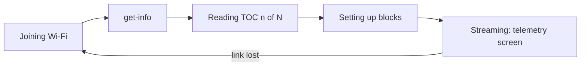

# Handheld boot and link animation -- design

Date: 2026-10-22. Branch `oled-boot-anim`. Approved by the user (style: stages + progress).

## Problem

The ground unit's OLED shows a static "Initializing..." splash, then a static
"NO CONNECTION" screen until LiteWing samples arrive. Nothing on screen moves, so
a frozen board, a slow handshake and a dead panel all look the same. The panel
is also on a flaky SDA wire (2026-10-22 probe: GPIO21 floats), so a panel that
misses its init stays blank until the next reboot.

## What it does

1. **Link screen (LiteWing mode).** Replaces the splash and the "NO CONNECTION"
   screen until the first sample. A spinner, the current stage, a progress bar
   driven by the real handshake, a row of stage dots, and the board's IP.
2. **Activity.** A one-pixel sweep under the header on the telemetry screen, so
   the screen visibly moves even when the numbers do not. The disconnect screen
   (all modes) gets a spinner.
3. **Panel watch.** Once a second the sketch probes I2C address 0x3C. Absent to
   present re-inits the panel; each change is logged as `[OLED] found` or
   `[OLED] not responding`.

## Progress bands

| Stage | Bar range | Driven by |
|---|---|---|
| Joining Wi-Fi | 0 to 20 | `WiFi.status()` |
| get-info | 20 to 30 | client state |
| Reading TOC | 30 to 85 | `tocRead / tocCount` |
| Setting up | 85 to 95 | client state |
| Streaming | 100 | client state |

TOC reading stops early once all wanted variables are found, so the bar jumps
from part-way to 85. That is honest: the remaining entries are never read.
`unsupported` shows its own label and an empty bar.

## Units

- `esp/boot_anim.h` -- plain C++, no Arduino: stage from (Wi-Fi, client state),
  percent, labels, stage dots, spinner frame, sweep position, and `PanelWatch`
  (probe schedule and present/absent transitions). Host-tested, >= 95% lines.
- `crtp_log.h` -- one new accessor, `tocRead()`.
- `esp.ino` -- drawing and the I2C probe only.

## Not doing

No timer-driven fake progress, no animation in NRF or SIM link stages beyond
the disconnect spinner, no change to the telemetry layout.

## Addendum -- 2026-10-22, after a power cycle left the panel blank

Measured on the handheld: SDA open for minutes at a time, and when closed the
panel answered 0/20 probes at 400 kHz, 3/20 at 100 kHz and 20/20 at 50 kHz.
u8g2 always runs the SH1106 at 400 kHz, so the panel could not work on this
wiring even when connected. Changes:

| Change | Why |
|---|---|
| `BusLadder`: probe at 400, 100, 50 kHz, use the fastest clean one | the library's clock was too fast for the contact |
| Down at once, up one rung after 5 clean rounds | a marginal clock must not flap |
| Re-send the panel's settings every second while answering, as bare commands | a glitch between probes can garble a panel that still answers |
| Drawing in its own task on core 0 | a 50 kHz frame takes about 200 ms, which would starve the link pump |
| `[OLED]` lines printed by `loop()` | two tasks writing Serial can split a TLM line |
| IP text in a fixed buffer | a String shared across tasks can be freed under the reader |

The first version of that refresh called `initDisplay()`. It waits out the
SH1106's 3 x 100 ms reset delays and starts with display OFF, so the screen froze
and flashed every second. It now sends `PANEL_REFRESH_CMDS`: the init settings
without display-off, contrast 0xFF, display-on last. Measured: probe round at
most 3 ms, frame at most 46 ms at 400 kHz.

The screen still blinked once a second with that sequence; with the refresh
disabled it stopped. Rewriting the scan-timing registers (0xD5, 0xA8, 0xDA,
0xD9, 0xDB, 0xD3, 0x8D, 0x20) restarts the scan even with the same value. The
refresh now carries only 0x40, 0xA1, 0xC8, 0x81 0xFF, 0xA4, 0xA6 and 0xAF, and
the screen is steady (confirmed by eye).
